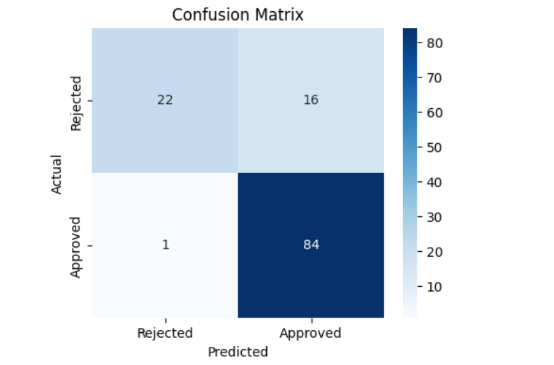
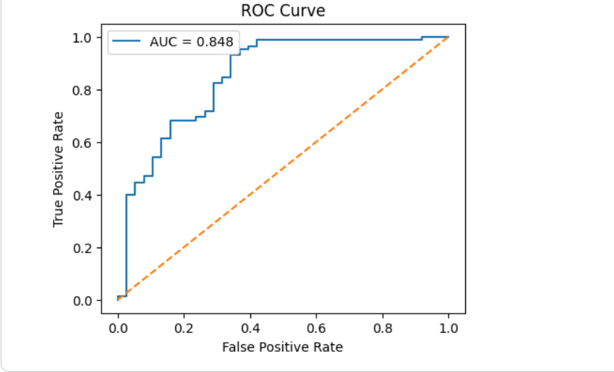
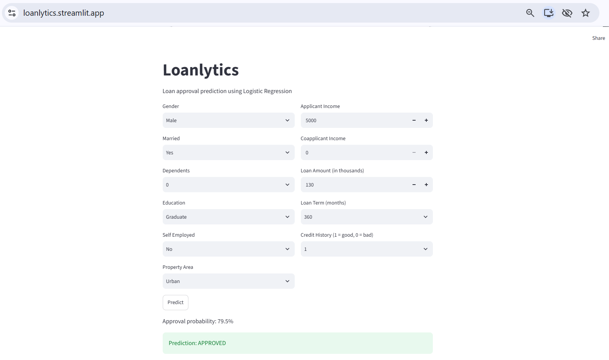

# Loanlytics

Loan approval prediction using Logistic Regression.

Live app: https://loanlytics.streamlit.app

## Problem
Predict whether a loan application will be approved or rejected, and give the approval probability. This is a binary classification problem. Target: Loan_Status (1 = approved, 0 = rejected).

## Dataset
Kaggle "Loan Prediction Problem Dataset" (train_u6lujuX_CVtuZ9i.csv). 614 rows and 13 columns. About 68.7% of loans are approved and 31.3% are rejected.

## Preprocessing
- Dropped Loan_ID
- Replaced Dependents "3+" with 3
- Filled missing values: mode for categorical columns, Loan_Amount_Term and Credit_History, median for LoanAmount
- Encoded Gender, Married, Education, Self_Employed and Loan_Status as 0/1
- One-hot encoded Property_Area
- Split the data 80/20 with stratify
- Scaled ApplicantIncome, CoapplicantIncome, LoanAmount and Loan_Amount_Term with StandardScaler (fitted on training data only)

## Model
Logistic Regression (scikit-learn) with a decision threshold of 0.5.

## Results (test set, 123 rows)
| Metric | Score |
|---|---|
| Accuracy | 0.86 |
| Precision (Approved) | 0.84 |
| Recall (Approved) | 0.99 |
| F1 (Approved) | 0.91 |
| Precision (Rejected) | 0.96 |
| Recall (Rejected) | 0.58 |
| ROC-AUC | 0.848 |

Confusion matrix: 22 true negatives, 16 false positives, 1 false negative, 84 true positives.

## Screenshots




## Limitations
- Small dataset (614 rows), so results can change with a different split.
- The model leans towards approving. It approved 16 of 38 applicants who should have been rejected.
- Credit_History is the main signal, so the model depends heavily on one feature.
- The data includes gender and marital status, which can cause unfair decisions in real use.
- Trained on one dataset only. This is a learning project and not for real lending decisions.

## Run locally
```
pip install -r requirements.txt
streamlit run app.py
```
