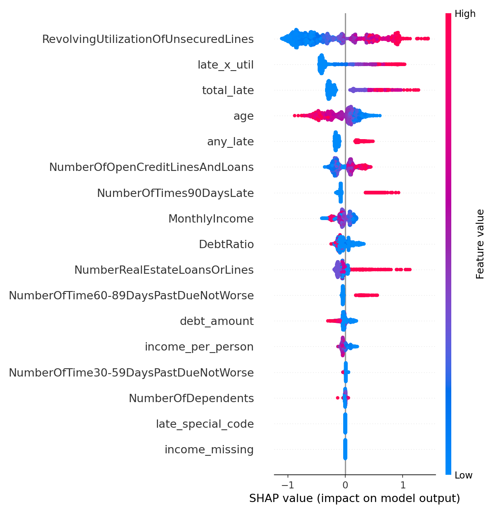

# Loanlytics: Credit Default Prediction

**Live app:** https://loanlytics.streamlit.app

Predicts whether a borrower will face serious delinquency (90+ days past due) within 2 years, with a risk probability for each customer.

## Problem
Binary classification. Target: `SeriousDlqin2yrs` (1 = defaulted within 2 years, 0 = did not). Only 6.7% of customers default, so the data is heavily imbalanced.

## Dataset
Kaggle "Give Me Some Credit" (`cs-training.csv`): 150,000 rows and 11 columns covering age, income, debt ratio, credit utilization, open credit lines and past-due history.

## Results (test set, 30,000 rows)

| Metric | Value |
|---|---|
| ROC-AUC | 0.870 |
| 5-fold CV ROC-AUC | 0.864 |
| Recall (defaulters caught) | 50% |
| Precision | 41% |
| F1 (default class) | 0.45 |

Confusion matrix (threshold 0.79): 26,540 true negatives, 1,455 false positives, 1,009 false negatives, 996 true positives.

The threshold was chosen on out-of-fold training predictions, not the test set, to avoid leakage.

## Model comparison (5-fold CV)

| Model | ROC-AUC | PR-AUC |
|---|---|---|
| Logistic Regression | 0.819 | 0.341 |
| Random Forest | 0.853 | 0.383 |
| **XGBoost** | **0.864** | **0.400** |

## Approach
1. **Cleaning:** median imputation for income (plus a missing flag), dependents filled with 0, removed ages 18 and under, capped extreme outliers, treated the 96/98 codes in the late-payment columns as special values.
2. **Split:** 80/20, stratified.
3. **Imbalance:** handled with `scale_pos_weight` and stratified folds.
4. **Features:** total late payments, late-payment-by-utilization interaction, income per person, debt amount.
5. **Tuning:** Optuna (20 trials) on XGBoost. Gains were marginal, so the model is near this dataset's ceiling.
6. **Explainability:** SHAP shows credit utilization, late payments and younger age as the main risk drivers.



## Files
- `loanlytics.ipynb`: full notebook
- `loanlytics_xgb.joblib`: trained model
- `config.json`: decision threshold and feature list
- `shap_summary.png`: SHAP plot

## Run locally
```
pip install pandas scikit-learn xgboost joblib
```

```python
import joblib, json

model = joblib.load('loanlytics_xgb.joblib')
cfg = json.load(open('config.json'))

# df must contain the columns in cfg['features']
proba = model.predict_proba(df[cfg['features']])[:, 1]
flagged = proba >= cfg['threshold']
```

## Limitations
- Precision is modest (41%), so this is a screening tool, not an automated decision-maker.
- Trained on one historical dataset; it needs validation before real-world use.
- Age is used as a feature, which may raise fairness concerns in real lending.

## Tech
Python, pandas, scikit-learn, XGBoost, Optuna, SHAP
